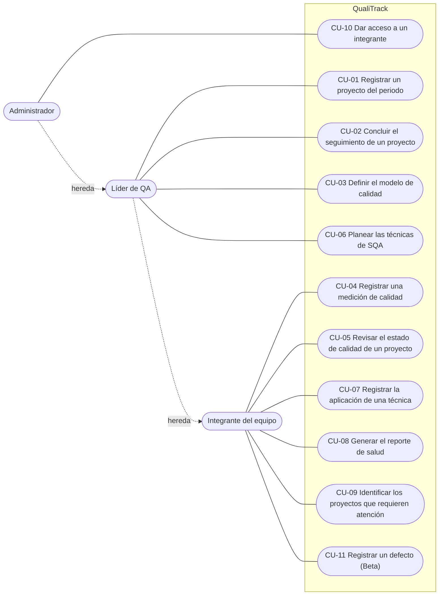

# Casos de uso · QualiTrack

Especificación de requisitos por casos de uso (producto de trabajo de la tarea SI.02.02 de ISO/IEC 29110). Complementa las [historias de usuario](HistoriasUsuario.md): cada caso de uso dice qué **objetivo** cumple un actor, y las historias dicen cómo se prueba.

**Regla para definir un caso de uso:** debe ser un objetivo propio del actor, no un paso previo. Es la corrección que hizo la maestra en TSP con los CU de Odín. Por eso "Iniciar sesión" no es un caso de uso, sino una precondición de todos.

## Actores

| Actor | Rol en el sistema | Qué busca |
| --- | --- | --- |
| Líder de QA | `lider_qa` | Decidir cómo se mide y se asegura la calidad de un proyecto |
| Integrante del equipo | `miembro` (incluye al líder del proyecto) | Registrar lo que pasa en el proyecto y saber cómo va |
| Administrador | `admin` | Dar acceso a las personas. Puede hacer todo lo del Líder de QA |

## Diagrama

## Resumen y estado

| CU | Nombre | Actor | Historias | Estado al 19/10 |
| --- | --- | --- | --- | --- |
| CU-01 | Registrar un proyecto del periodo | Líder de QA | HU-01, HU-03 | Implementado |
| CU-02 | Concluir el seguimiento de un proyecto | Líder de QA | HU-03 | Implementado |
| CU-03 | Definir el modelo de calidad del proyecto | Líder de QA | HU-04 | **Parcial:** reglas y API listas; falta la pantalla y la selección por proyecto |
| CU-04 | Registrar una medición de calidad | Integrante | HU-05 | Implementado |
| CU-05 | Revisar el estado de calidad de un proyecto | Integrante | HU-06 | Implementado |
| CU-06 | Planear las técnicas de SQA del proyecto | Líder de QA | HU-07 | Implementado |
| CU-07 | Registrar la aplicación de una técnica | Integrante | HU-08 | Implementado |
| CU-08 | Generar el reporte de salud de un proyecto | Integrante | HU-09 | Implementado |
| CU-09 | Identificar los proyectos que requieren atención | Integrante | HU-02 | Implementado |
| CU-10 | Dar acceso a un integrante | Administrador | HU-10 | **Parcial:** solo API; falta la pantalla |
| CU-11 | Registrar un defecto del proyecto | Integrante | HU-11 (nueva) | **Propuesto** para la Beta |

---

## CU-01 — Registrar un proyecto del periodo

| | |
| --- | --- |
| **ID** | CU-01 |
| **Actor** | Líder de QA |
| **Descripción** | El Líder de QA registra un proyecto de software en un periodo escolar para empezar a dar seguimiento a su calidad. |

**Precondiciones**
- El Líder de QA inició sesión.

**Flujo normal**
1. El Líder de QA indica que quiere registrar un proyecto nuevo.
2. El sistema muestra el formulario del proyecto.
3. El Líder de QA captura nombre, periodo (AAAA-1 o AAAA-2), descripción, URL del repositorio, equipo y responsable de QA.
4. El sistema valida los datos.
5. El sistema verifica que el proyecto no esté registrado en ese periodo.
6. El sistema guarda el proyecto y lo muestra en la lista del periodo, con salud "sin datos".

**Flujos alternativos**
- **A4.1 Datos inválidos.** El sistema muestra el error junto a cada campo inválido y conserva lo capturado. El Líder de QA corrige y se vuelve al paso 4.
- **A5.1 Proyecto repetido en el periodo.** El sistema informa que ya existe un proyecto con ese nombre en ese periodo. El Líder de QA puede cambiar el nombre o el periodo; el mismo nombre en otro periodo sí se permite.
- **A1.1 Corregir un proyecto registrado.** El Líder de QA abre el proyecto y elige "Editar". El flujo sigue desde el paso 2 con los datos actuales.

**Postcondiciones**
- El proyecto queda registrado en el periodo, listo para medir y planear técnicas.

**Requerimientos funcionales**

| ID | Requerimiento |
| --- | --- |
| RF-01 | El sistema deberá permitir al Líder de QA registrar un proyecto con nombre, periodo, descripción, repositorio, equipo y responsable de QA. |
| RF-02 | El sistema deberá aceptar solo periodos con el formato AAAA-1 o AAAA-2 y URL de repositorio completas. |
| RF-03 | El sistema deberá impedir registrar dos veces el mismo nombre de proyecto en un periodo. |
| RF-04 | El sistema deberá mostrar cada error de validación junto al campo que lo causa. |
| RF-05 | El sistema deberá permitir al Líder de QA corregir los datos de un proyecto registrado. |

## CU-02 — Concluir el seguimiento de un proyecto

| | |
| --- | --- |
| **ID** | CU-02 |
| **Actor** | Líder de QA |
| **Descripción** | El Líder de QA archiva un proyecto que terminó, para que ya no aparezca en el periodo ni reciba mediciones, sin perder su historial. |

**Precondiciones**
- El proyecto está registrado y no está archivado.

**Flujo normal**
1. El Líder de QA abre el proyecto.
2. El Líder de QA elige "Archivar".
3. El sistema marca el proyecto como archivado.
4. El sistema lo quita de la lista del periodo.

**Flujos alternativos**
- **A1.1 Consultar un proyecto archivado.** En la lista, el actor activa "Ver archivados" y el sistema los muestra con la etiqueta "Archivado".
- **A2.1 Restaurar.** En un proyecto archivado, el Líder de QA elige "Restaurar" y el proyecto vuelve a la lista y acepta mediciones.

**Postcondiciones**
- El proyecto conserva sus mediciones, técnicas y reportes, pero no acepta mediciones nuevas mientras esté archivado.

| ID | Requerimiento |
| --- | --- |
| RF-06 | El sistema deberá permitir al Líder de QA archivar y restaurar un proyecto. |
| RF-07 | El sistema deberá ocultar los proyectos archivados de la lista, salvo que el actor pida verlos. |
| RF-08 | El sistema deberá rechazar mediciones nuevas en un proyecto archivado. |

## CU-03 — Definir el modelo de calidad del proyecto

| | |
| --- | --- |
| **ID** | CU-03 |
| **Actor** | Líder de QA |
| **Descripción** | El Líder de QA decide qué métricas usa el proyecto y con qué valores peor y mejor se calificará cada una, sabiendo de dónde sale cada criterio ([ADR-004](../02-diseno/decisiones/ADR-004-modelo-metricas.md)). |

**Precondiciones**
- El catálogo trae las 6 métricas base y 3 opcionales, cada una con factor ISO/IEC 25010, fórmula y fuente.

**Flujo normal**
1. El Líder de QA abre el modelo de calidad del proyecto.
2. El sistema muestra cada métrica con su factor y criterio, su fórmula, sus valores peor y mejor, la fuente de esos valores y si está activa.
3. El Líder de QA activa o desactiva métricas y ajusta los valores peor y mejor que el equipo acordó.
4. El sistema valida que el valor peor no sea mejor que el mejor.
5. El sistema guarda el modelo y recalcula el semáforo y el índice con las métricas activas.

**Flujos alternativos**
- **A3.1 Agregar una métrica propia.** El Líder de QA captura código, nombre, unidad, si mayor o menor es mejor, peor, mejor, criterio y fuente. El sistema verifica que el código no exista.
- **A4.1 Peor y mejor al revés.** El sistema informa "El valor peor no puede ser mejor que el valor mejor" y no guarda.
- **A3.2 Desactivar una métrica con historial.** El sistema conserva sus mediciones, pero deja de pedirla y de contarla.

**Postcondiciones**
- El semáforo y el índice del proyecto usan el modelo guardado.

| ID | Requerimiento |
| --- | --- |
| RF-09 | El sistema deberá mostrar, para cada métrica, su factor y criterio de ISO/IEC 25010, su fórmula y la fuente de sus valores peor y mejor. |
| RF-10 | El sistema deberá permitir al Líder de QA activar y desactivar métricas sin perder sus mediciones. |
| RF-11 | El sistema deberá permitir al Líder de QA ajustar los valores peor y mejor de cada métrica. |
| RF-12 | El sistema deberá rechazar un modelo en el que el valor peor sea mejor que el mejor. |
| RF-13 | El sistema deberá permitir agregar métricas propias del equipo. |
| RF-14 | *(Beta)* El sistema deberá guardar el modelo **por proyecto**, para que cada equipo tenga el suyo. |

## CU-04 — Registrar una medición de calidad

| | |
| --- | --- |
| **ID** | CU-04 |
| **Actor** | Integrante del equipo |
| **Descripción** | El integrante anota el valor que obtuvo una métrica en una fecha, para que el proyecto refleje cómo va. |

**Precondiciones**
- El proyecto no está archivado y tiene al menos una métrica activa.

**Flujo normal**
1. El integrante abre el proyecto en la pestaña Métricas.
2. El integrante elige la métrica y captura el valor, la fecha y una nota opcional.
3. El sistema valida la medición.
4. El sistema la guarda y calcula su semáforo con los valores peor y mejor.
5. El sistema actualiza la tabla de estado y la gráfica de tendencia.

**Flujos alternativos**
- **A3.1 Fecha futura.** El sistema informa que la fecha no puede ser futura. "Hoy" es el día en Zacatecas (DEF-003).
- **A3.2 Valor no numérico o fecha inválida.** El sistema marca el campo con el error.
- **A3.3 Métrica inactiva.** El sistema informa que la métrica no está activa en el modelo.
- **A1.1 Proyecto archivado.** El sistema no muestra el formulario.

**Postcondiciones**
- La medición queda en el historial de la métrica, y el semáforo usa la más reciente.

| ID | Requerimiento |
| --- | --- |
| RF-15 | El sistema deberá permitir a cualquier integrante registrar una medición con métrica, valor, fecha y nota. |
| RF-16 | El sistema deberá rechazar fechas futuras según el calendario de la zona horaria de la aplicación. |
| RF-17 | El sistema deberá calcular el semáforo: verde si llega al mejor, amarillo entre peor y mejor, rojo si es peor que el peor. |
| RF-18 | El sistema deberá rechazar mediciones de métricas inactivas y de proyectos archivados. |

## CU-05 — Revisar el estado de calidad de un proyecto

| | |
| --- | --- |
| **ID** | CU-05 |
| **Actor** | Integrante del equipo |
| **Descripción** | El integrante revisa cómo va cada métrica del proyecto y su tendencia, para decidir en qué trabajar. |

**Flujo normal**
1. El integrante abre el proyecto.
2. El sistema muestra cada métrica activa con su último valor, sus valores peor y mejor, su semáforo, su criterio y la fecha.
3. El integrante elige una métrica en la gráfica.
4. El sistema muestra su tendencia con las líneas de mejor y peor.
5. El integrante consulta la tabla "Modelo de calidad" para ver de dónde sale cada criterio.

**Flujos alternativos**
- **A2.1 Métrica sin mediciones.** El sistema la muestra "sin datos" y no la cuenta en el índice.

| ID | Requerimiento |
| --- | --- |
| RF-19 | El sistema deberá mostrar el último valor y el semáforo de cada métrica activa del proyecto. |
| RF-20 | El sistema deberá graficar la tendencia de una métrica con sus líneas de mejor y peor. |
| RF-21 | El sistema deberá mostrar el modelo de calidad (criterio, fórmula y fuente) junto a las métricas. |

## CU-06 — Planear las técnicas de SQA del proyecto

| | |
| --- | --- |
| **ID** | CU-06 |
| **Actor** | Líder de QA |
| **Descripción** | El Líder de QA decide qué técnicas de aseguramiento aplica el proyecto, cada cuándo y quién es responsable. |

**Flujo normal**
1. El Líder de QA abre la pestaña Técnicas.
2. El sistema muestra el plan actual con el estado de cada técnica (al día o atrasada) y el cumplimiento.
3. El Líder de QA elige una técnica del catálogo, su frecuencia (por PR, semanal, por check-in o mensual) y el responsable.
4. El sistema la agrega al plan.

**Flujos alternativos**
- **A3.1 Técnica repetida.** El sistema informa que la técnica ya está en el plan.
- **A3.2 Quitar una técnica.** El Líder de QA elige "Quitar" y el sistema la saca del plan.

| ID | Requerimiento |
| --- | --- |
| RF-22 | El sistema deberá permitir al Líder de QA agregar técnicas al plan con frecuencia y responsable, sin repetirlas. |
| RF-23 | El sistema deberá marcar como atrasada una técnica sin ejecución dentro de su ventana (7, 7, 14 o 30 días). |
| RF-24 | El sistema deberá calcular el cumplimiento del plan como técnicas al día ÷ técnicas del plan. |

## CU-07 — Registrar la aplicación de una técnica

| | |
| --- | --- |
| **ID** | CU-07 |
| **Actor** | Integrante del equipo |
| **Descripción** | El integrante anota que aplicó una técnica del plan (por ejemplo, una revisión de código) con su resultado y sus hallazgos. |

**Precondiciones**
- La técnica está en el plan del proyecto.

**Flujo normal**
1. El integrante elige la técnica en "Registrar ejecución".
2. El integrante captura la fecha, el responsable, el resultado (aprobada, con hallazgos o rechazada), el número de hallazgos y notas.
3. El sistema valida la ejecución.
4. El sistema la guarda, la muestra en el historial y recalcula el cumplimiento del plan.

**Flujos alternativos**
- **A3.1 Aprobada con hallazgos.** El sistema informa que una ejecución aprobada no puede tener hallazgos.
- **A3.2 Fecha futura.** El sistema rechaza la fecha.

| ID | Requerimiento |
| --- | --- |
| RF-25 | El sistema deberá permitir registrar ejecuciones de técnicas con fecha, responsable, resultado, hallazgos y notas. |
| RF-26 | El sistema deberá rechazar ejecuciones "aprobadas" con hallazgos y fechas futuras. |
| RF-27 | El sistema deberá mostrar el historial de ejecuciones del más reciente al más antiguo. |

## CU-08 — Generar el reporte de salud de un proyecto

| | |
| --- | --- |
| **ID** | CU-08 |
| **Actor** | Integrante del equipo (normalmente el líder del proyecto) |
| **Descripción** | El integrante obtiene un número de 0 a 100 que resume la salud del proyecto, con lo que requiere atención, y lo guarda o lo exporta para un check-in. |

**Flujo normal**
1. El integrante abre la pestaña Reporte.
2. El sistema calcula el índice: promedia los indicadores (verde 100, amarillo 50, rojo 0), contando el plan de técnicas como uno más.
3. El sistema muestra el índice, su nivel, los indicadores por color, el cumplimiento del plan, los defectos críticos y la lista de lo que requiere atención.
4. El integrante elige "Guardar en historial".
5. El sistema guarda el reporte con la fecha y un resumen en texto.
6. El integrante elige "Exportar PDF" y el navegador abre el diálogo de impresión.

**Flujos alternativos**
- **A2.1 Defectos críticos abiertos.** El índice no pasa de 79 y el reporte lo dice.
- **A2.2 Sin datos.** El sistema indica "sin datos suficientes" en lugar del índice.

| ID | Requerimiento |
| --- | --- |
| RF-28 | El sistema deberá calcular el índice de salud como promedio de indicadores, con tope de 79 si hay defectos críticos abiertos. |
| RF-29 | El sistema deberá listar las métricas y el plan que no estén en verde. |
| RF-30 | El sistema deberá guardar reportes con fecha y resumen, y mostrarlos en un historial. |
| RF-31 | El sistema deberá permitir exportar el reporte a PDF. |

## CU-09 — Identificar los proyectos que requieren atención

| | |
| --- | --- |
| **ID** | CU-09 |
| **Actor** | Integrante del equipo (y la maestra, como cliente, en la demo) |
| **Descripción** | El actor ve todos los proyectos de un periodo con su salud, para saber cuáles necesitan atención. |

**Flujo normal**
1. El actor entra a QualiTrack.
2. El sistema muestra el periodo más reciente con el total de proyectos, la salud promedio, los defectos críticos abiertos y cada proyecto con su semáforo.
3. El actor cambia de periodo si lo necesita.
4. El actor abre el proyecto que le interesa (CU-05 o CU-08).

**Flujos alternativos**
- **A2.1 Periodo sin proyectos.** El sistema lo indica.

| ID | Requerimiento |
| --- | --- |
| RF-32 | El sistema deberá listar los proyectos de un periodo con su índice y nivel de salud. |
| RF-33 | El sistema deberá mostrar el total de proyectos, la salud promedio y los defectos críticos abiertos del periodo. |

## CU-10 — Dar acceso a un integrante

| | |
| --- | --- |
| **ID** | CU-10 |
| **Actor** | Administrador |
| **Descripción** | El Administrador da de alta a una persona con su rol, para que pueda usar QualiTrack con los permisos que le corresponden. |

**Flujo normal**
1. El Administrador abre la pantalla de usuarios *(Beta)*.
2. El Administrador captura nombre, correo, contraseña inicial y rol.
3. El sistema valida y guarda el usuario.

**Flujos alternativos**
- **A3.1 Correo repetido o inválido.** El sistema informa el error.
- **A1.1 Un Líder de QA o un Miembro intenta entrar.** El sistema niega el acceso (403).

| ID | Requerimiento |
| --- | --- |
| RF-34 | El sistema deberá permitir solo al Administrador registrar usuarios con rol Administrador, Líder de QA o Miembro. |
| RF-35 | El sistema deberá aplicar los permisos por rol en cada operación: un Miembro no crea proyectos, métricas ni planes. |

## CU-11 — Registrar un defecto del proyecto *(propuesto para la Beta)*

| | |
| --- | --- |
| **ID** | CU-11 |
| **Actor** | Integrante del equipo |
| **Descripción** | El integrante registra los defectos del proyecto y los cierra al corregirlos. Así QualiTrack calcula solo 4 de las 6 métricas, sin conteos a mano. |

**Flujo normal**
1. El integrante abre la pestaña Defectos.
2. El integrante captura descripción, gravedad (crítica, mayor, menor o cosmética), tipo TSP, fecha y quién lo encontró: el equipo, el cliente en una revisión o alguien después de entregar.
3. El sistema guarda el defecto como abierto.
4. Al corregirlo, el integrante registra la fecha de cierre.
5. El sistema recalcula la densidad de defectos, los críticos abiertos, la eficiencia de QA (A, B y C según quién lo encontró) y el tiempo medio de corrección.

**Flujos alternativos**
- **A4.1 Fecha de cierre anterior a la de registro.** El sistema la rechaza.

| ID | Requerimiento |
| --- | --- |
| RF-36 | El sistema deberá permitir registrar y cerrar defectos con gravedad, tipo TSP, fechas y quién los encontró. |
| RF-37 | El sistema deberá calcular la densidad de defectos, los críticos abiertos, la eficiencia de QA y el tiempo medio de corrección a partir del registro de defectos. |
| RF-38 | El sistema deberá usar el número de historias entregadas del proyecto (capacidad funcional) como tamaño para la densidad. |

---

## Trazabilidad CU → historias → pruebas

| CU | RF | Historias | Pruebas que lo cubren |
| --- | --- | --- | --- |
| CU-01 | RF-01 a RF-05 | HU-01, HU-03 | `projects.test.ts`, `components.test.tsx` (ProjectForm) |
| CU-02 | RF-06 a RF-08 | HU-03 | `projects.test.ts` "consulta, edita y archiva", `metrics.test.ts` "no admite mediciones en proyectos archivados" |
| CU-03 | RF-09 a RF-14 | HU-04 | `metrics.test.ts` (modelo, peor/mejor, inactivas), `unit.test.ts` (semáforo, migración) |
| CU-04 | RF-15 a RF-18 | HU-05 | `metrics.test.ts` "registra mediciones…", "rechaza fechas futuras…", `unit.test.ts` DEF-003 |
| CU-05 | RF-19 a RF-21 | HU-06 | `metrics.test.ts` "el semáforo usa la última medición", `components.test.tsx` (gráfica) |
| CU-06 | RF-22 a RF-24 | HU-07 | `techniques-health.test.ts`, `unit.test.ts` (cumplimiento) |
| CU-07 | RF-25 a RF-27 | HU-08 | `techniques-health.test.ts` "valida las ejecuciones" |
| CU-08 | RF-28 a RF-31 | HU-09 | `unit.test.ts` (índice), `techniques-health.test.ts` (reportes) |
| CU-09 | RF-32, RF-33 | HU-02 | `projects.test.ts` "lista por periodo…", `format.test.ts` |
| CU-10 | RF-34, RF-35 | HU-10 | `auth.test.ts`, pruebas 403 de cada módulo |
| CU-11 | RF-36 a RF-38 | HU-11 | Por escribir en la Beta |

La división de las actividades de implementación por caso de uso está en el [Plan del ciclo 3](../03-planeacion-tsp/PlanCiclo3.md).
