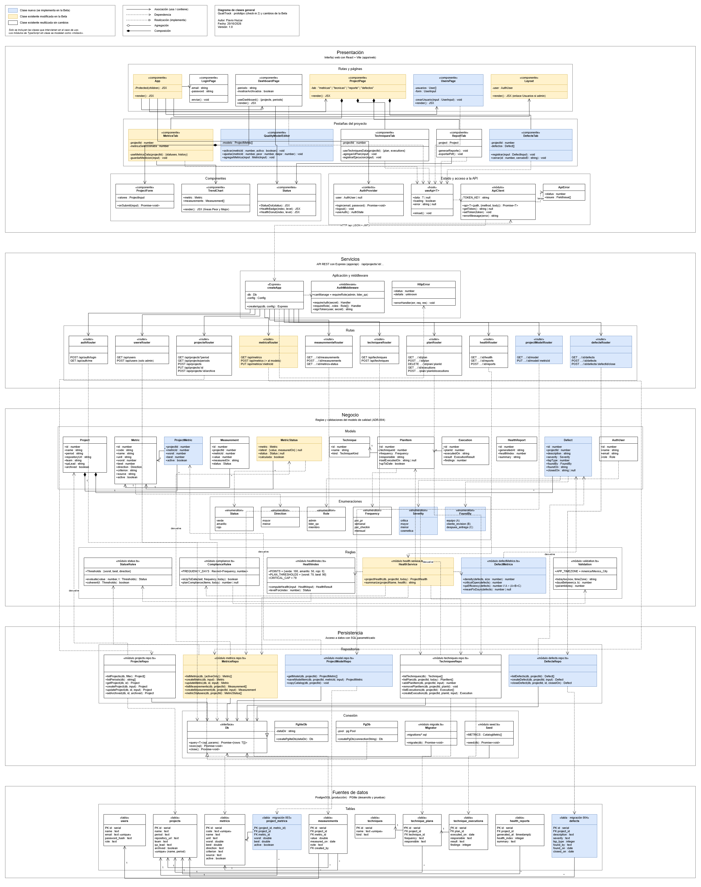
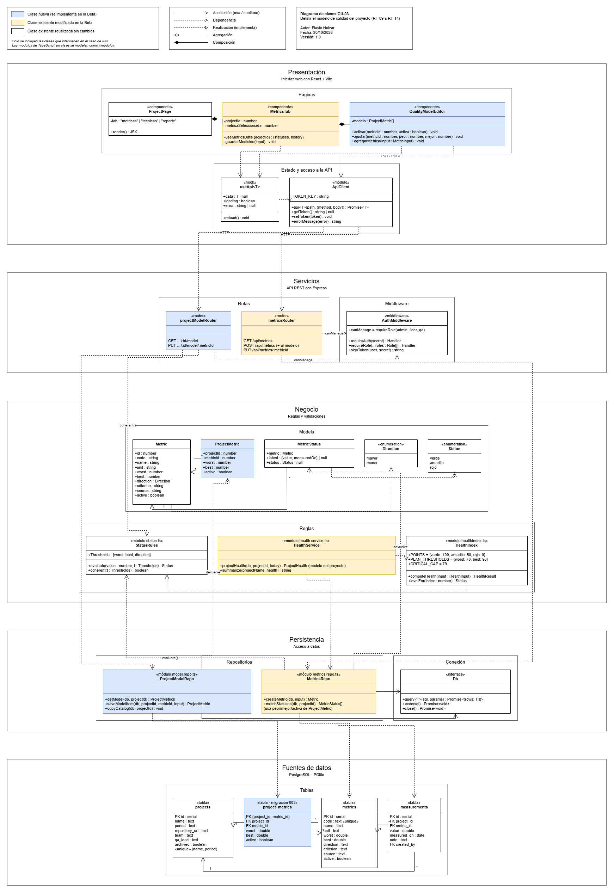
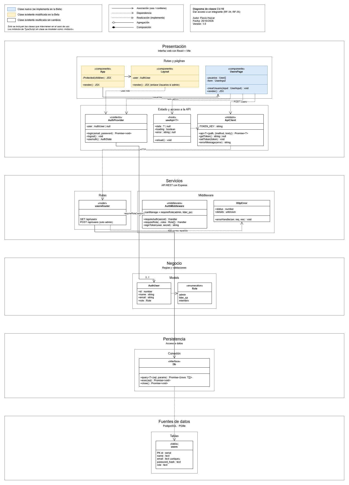
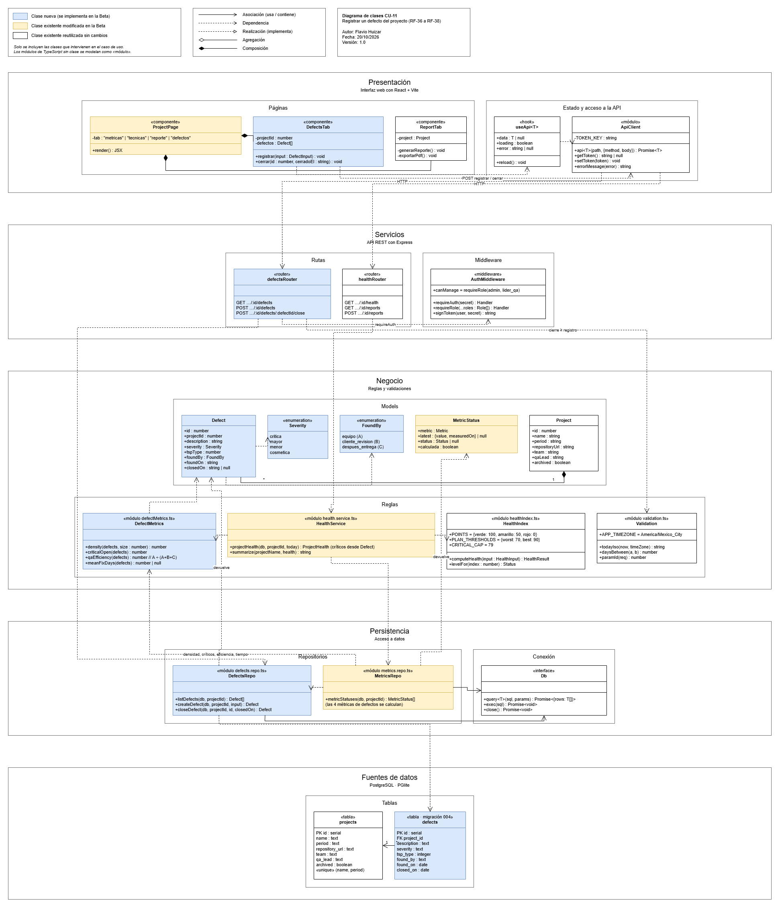

# Diagramas de clases de QualiTrack

Autor: Flavio Huizar · Versión 1.0 · 20/10/2026. Casos de uso en [CasosDeUso.md](../01-requisitos/CasosDeUso.md); decisiones de diseño en [decisiones/](decisiones/).

## 1. Propósito

Muestran cómo está construido QualiTrack por capas y qué clases se crean o cambian en cada caso de uso de la Beta (ciclo 3). Siguen el formato de los diagramas de clases de TSP: capas como contenedores, subgrupos por tipo de clase y colores para distinguir lo nuevo de lo existente.

El archivo editable es [`DiagramasClases.drawio`](DiagramasClases.drawio). Se abre en diagrams.net (app.diagrams.net o la aplicación de escritorio) y tiene una página por diagrama.

## 2. Convenciones

| Elemento | Significado |
| --- | --- |
| Azul | Clase nueva: se implementa en la Beta |
| Amarillo | Clase existente que se modifica en la Beta |
| Blanco | Clase existente que se reutiliza sin cambios |
| «componente», «hook», «contexto» | Elementos de React en la capa de presentación |
| «router», «middleware» | Rutas y filtros de Express en la capa de servicios |
| «módulo» | Archivo de TypeScript con funciones (no tiene clase); se modela como clase con sus funciones exportadas |
| «tabla» | Tabla de PostgreSQL; las nuevas indican su migración (003, 004) |
| «enumeration» | Valores permitidos (CHECK en la base de datos) |

Relaciones: asociación (flecha continua), dependencia (flecha punteada), realización (punteada con triángulo), composición (rombo relleno). Las multiplicidades (1, \*) aparecen en las llaves foráneas y entre modelos.

## 3. Capas

| Capa | Tecnología | Qué contiene |
| --- | --- | --- |
| Presentación | React + Vite (`apps/web`) | Páginas, pestañas del proyecto, componentes, sesión (`AuthProvider`) y cliente de la API |
| Servicios | Express (`apps/api`) | `createApp`, rutas REST por módulo, autenticación JWT y permisos por rol, manejo de errores |
| Negocio | TypeScript | Modelos, enumeraciones y reglas: semáforo peor/mejor (`StatusRules`), cumplimiento del plan, índice de salud (ADR-004) |
| Persistencia | SQL parametrizado | Repositorios por módulo y la interfaz `Db`, implementada por PGlite (desarrollo y pruebas) y PostgreSQL (producción) |
| Fuentes de datos | PostgreSQL / PGlite | Tablas creadas por las migraciones 001 y 002; la Beta agrega 003 (`project_metrics`) y 004 (`defects`) |

Cada capa solo usa a la inmediata inferior. Las reglas de negocio no dependen de la base de datos: `computeHealth`, `evaluate` y `planCompliance` son funciones puras y por eso tienen pruebas unitarias directas.

## 4. Páginas del diagrama

| Página | Caso de uso | Clases nuevas | Clases modificadas |
| --- | --- | --- | --- |
| Diagrama de clases general | Todos | Todas las de la Beta | Todas las de la Beta |
| Diagrama de clases CU-03 | Definir el modelo de calidad del proyecto | `QualityModelEditor`, `projectModelRouter`, `ProjectMetric`, `ProjectModelRepo`, tabla `project_metrics` | `MetricsTab`, `metricsRouter`, `HealthService`, `MetricsRepo` |
| Diagrama de clases CU-10 | Dar acceso a un integrante | `UsersPage` | `App` (ruta /usuarios), `Layout` (enlace solo para el Administrador) |
| Diagrama de clases CU-11 | Registrar un defecto del proyecto | `DefectsTab`, `defectsRouter`, `Defect`, `Severity`, `FoundBy`, `DefectMetrics`, `DefectsRepo`, tabla `defects` | `ProjectPage` (pestaña Defectos), `MetricStatus`, `HealthService`, `MetricsRepo` |

Los casos de uso CU-01, CU-02 y CU-04 a CU-09 ya están implementados en el prototipo; sus clases aparecen en blanco en el diagrama general.

## 5. Relación con el plan del ciclo 3

Las clases nuevas y modificadas de cada página son las que implementan las tareas 3 a 10 del [Plan del ciclo 3](../03-planeacion-tsp/PlanCiclo3.md). El revisor de cada PR usa la página del caso de uso para verificar que el código siga el diseño: mismas capas, mismos nombres y ninguna dependencia hacia arriba.

## 6. Diagramas

### Diagrama de clases general

### CU-03 · Definir el modelo de calidad del proyecto

### CU-10 · Dar acceso a un integrante

### CU-11 · Registrar un defecto del proyecto

