# Manual de usuario · QualiTrack 1.0

QualiTrack es el centro de control de aseguramiento de la calidad (SQA) de los proyectos de un equipo. En él se registra cada proyecto del periodo, se miden sus métricas de calidad contra un modelo definido, se planean y registran las técnicas de SQA y se obtiene un reporte del estado de salud de cada proyecto.

**Dónde está:** https://qualitrack-x1u0.onrender.com. Para correrlo en una computadora propia, sigue el [README](../../README.md#cómo-correrlo).

Las capturas son de la versión 1.0 con los datos de ejemplo. El proyecto que se ve es "QualiTrack", que lleva el registro real de este mismo desarrollo.

## 1. Roles y permisos

Cada persona entra con el correo y la contraseña que le dio el Administrador. No hay registro abierto: el Administrador da de alta a cada integrante (sección 9).

| Puede… | Administrador | Líder de QA | Miembro |
| --- | :-: | :-: | :-: |
| Ver proyectos, métricas, técnicas, defectos y reportes | Sí | Sí | Sí |
| Registrar mediciones, ejecuciones de técnicas y defectos; cerrar defectos | Sí | Sí | Sí |
| Guardar el reporte en el historial y exportarlo a PDF | Sí | Sí | Sí |
| Registrar, editar y archivar proyectos | Sí | Sí | No |
| Cambiar el modelo de calidad y agregar métricas propias | Sí | Sí | No |
| Armar el plan de técnicas del proyecto | Sí | Sí | No |
| Dar acceso a integrantes (pantalla Usuarios) | Sí | No | No |

Lo que un rol no puede hacer no aparece en su pantalla. Si alguien lo intenta directo en la API, recibe "Tu rol no tiene permiso para esta acción".

## 2. Iniciar sesión

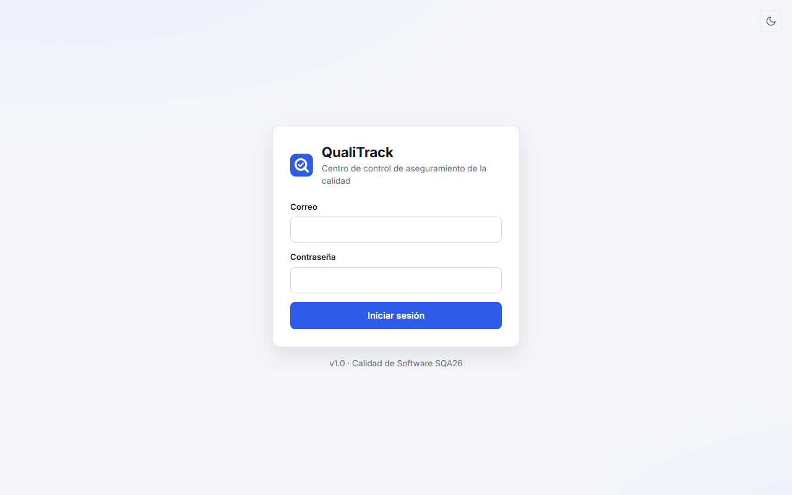

1. Escribe tu correo y tu contraseña.
2. Da clic en **Iniciar sesión**.

Si algún dato está mal aparece "Correo o contraseña incorrectos". El mensaje no dice cuál de los dos falló, a propósito. El botón de la luna, arriba a la derecha, cambia a modo oscuro (sección 10).

Para salir, usa el botón con la flecha junto a tu nombre. La sesión también se cierra sola cuando expira; QualiTrack te avisa y te regresa a esta pantalla.

## 3. Dashboard de proyectos

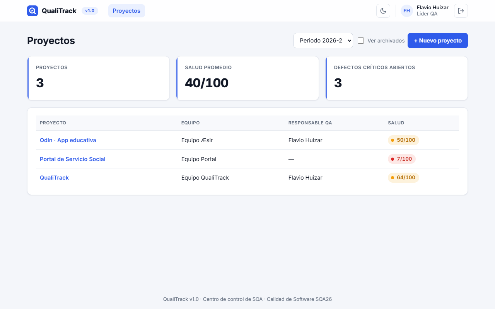

Es la primera pantalla después de entrar. Muestra los proyectos del periodo elegido:

- **Arriba:** cuántos proyectos hay, la salud promedio y los defectos críticos abiertos entre todos.
- **La tabla:** cada proyecto con su equipo, su responsable de QA y su índice de salud con semáforo. "Sin datos" quiere decir que el proyecto todavía no tiene mediciones.
- **Periodo:** la lista de arriba cambia de periodo (por ejemplo 2026-2).
- **Ver archivados:** muestra también los proyectos archivados.

Da clic en el nombre de un proyecto para abrirlo.

## 4. Registrar, editar y archivar un proyecto

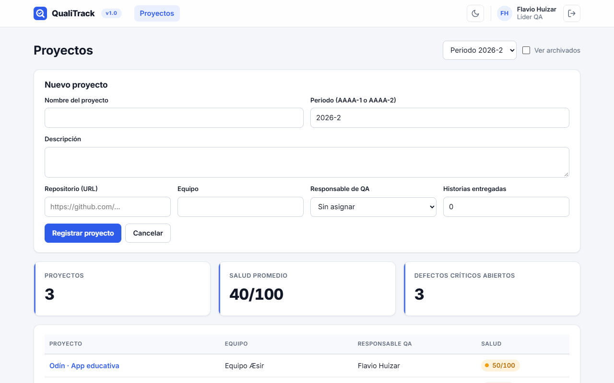

1. En el dashboard, da clic en **+ Nuevo proyecto**.
2. Llena el formulario:
   - **Nombre del proyecto** y **Periodo**, con el formato `AAAA-1` o `AAAA-2`. Solo puede haber un proyecto con el mismo nombre en cada periodo.
   - **Responsable de QA:** se elige de la lista de usuarios, o se deja "Sin asignar".
   - **Historias entregadas:** sirve para calcular la densidad de defectos. Se puede capturar después.
   - Descripción, repositorio y equipo son opcionales.
3. Da clic en **Registrar proyecto**. QualiTrack abre el proyecto nuevo.

Si un dato no es válido, el mensaje aparece debajo del campo y dice cómo corregirlo. Por ejemplo, con un nombre repetido sale: *Ya hay un proyecto llamado "…" en el periodo 2026-2; cambia el nombre o el periodo*.

Dentro del proyecto:
- **Editar** abre el mismo formulario con los datos actuales.
- **Archivar** lo guarda como solo lectura: ya no acepta mediciones, defectos ni cambios en su modelo, y sale del dashboard (salvo con "Ver archivados").
- **Restaurar** lo regresa a activo.

## 5. Métricas

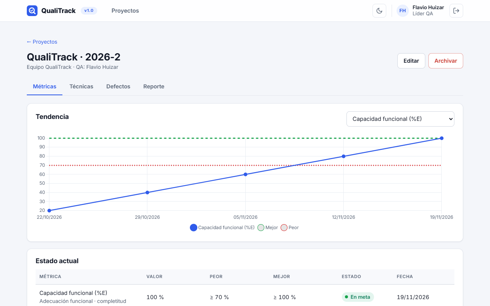

La pestaña **Métricas** es la que se abre primero en cada proyecto.

- **Tendencia:** la gráfica de una métrica en el tiempo. La línea verde es el valor mejor y la roja, el peor. La lista de la derecha cambia de métrica.
- **Estado actual:** la última medición de cada métrica activa, con su valor peor, su valor mejor y su semáforo:
  - **En meta** (verde): llega al valor mejor.
  - **En riesgo** (amarillo): está entre el peor y el mejor.
  - **Fuera de meta** (rojo): es peor que el valor peor.
- En la columna **Fecha**, "Registro de defectos" indica que la métrica se calcula sola a partir de la pestaña Defectos (sección 7). A esas no se les captura medición.

### Registrar una medición

1. Elige la **Métrica**.
2. Escribe el **Valor**, en la unidad que indica la tabla (%, días, por funcionalidad…).
3. Revisa la **Fecha**. Por omisión es hoy, y no se aceptan fechas futuras.
4. Si quieres, agrega una **Nota**, por ejemplo "después de la revisión del sprint".
5. Da clic en **+ Registrar medición**. Aparece "Medición registrada." y la tabla y la gráfica se actualizan.

### Modelo de calidad

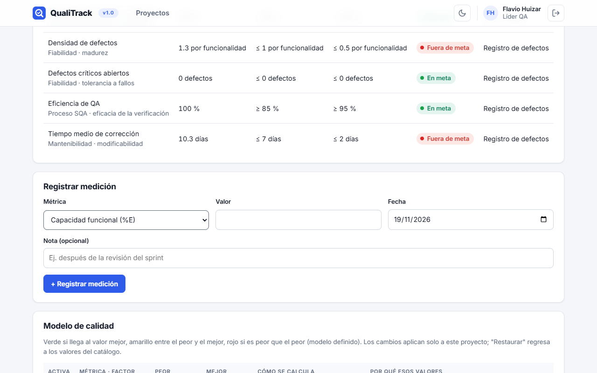

Abajo de la pestaña está el modelo con el que se evalúa el proyecto. Cada métrica tiene su criterio de ISO/IEC 25010, su valor peor y mejor, cómo se calcula y por qué se eligieron esos valores. Solo el Administrador y el Líder de QA lo pueden cambiar:

- **Activa:** desmarca una métrica para que no cuente en el índice de este proyecto.
- **Peor y mejor:** edita los valores y guarda. Los dos son obligatorios: si dejas uno vacío, QualiTrack lo marca en lugar de guardarlo como 0.
- **Restaurar:** regresa la métrica a los valores del catálogo.
- **+ Agregar métrica propia:** crea una métrica con código, nombre, unidad, si es mejor alta o baja, valor peor y mejor, su criterio de ISO/IEC 25010 y de dónde salen el peor y el mejor.

Los cambios valen solo para este proyecto; los demás no se ven afectados.

## 6. Técnicas de SQA

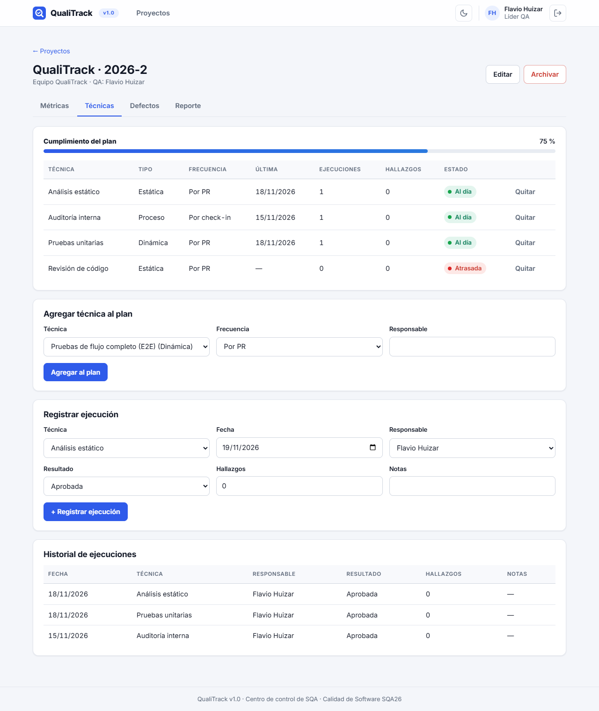

- **Cumplimiento del plan:** el porcentaje de técnicas al día. Cada técnica dice cuándo se aplicó por última vez, cuántas veces y cuántos hallazgos tuvo. "Atrasada" quiere decir que ya le tocaba según su frecuencia.
- **Agregar técnica al plan** (Administrador y Líder de QA): elige la técnica, su frecuencia (por PR, semanal, por check-in o mensual) y su responsable, y da clic en **Agregar al plan**. Una técnica que ya está en el plan no se puede agregar otra vez: se registra una ejecución.
- **Quitar** saca la técnica del plan.

### Registrar una ejecución

1. Elige la **Técnica** y revisa la **Fecha**.
2. **Responsable:** se elige de la lista de usuarios; por omisión aparece quien tiene la sesión abierta.
3. Elige el **Resultado** (Aprobada, Con hallazgos o Rechazada) y anota cuántos **Hallazgos** hubo. Una ejecución "Aprobada" no admite hallazgos: si los hubo, elige "Con hallazgos".
4. Da clic en **+ Registrar ejecución**. La ejecución sale en el **Historial de ejecuciones** y el cumplimiento se recalcula.

## 7. Defectos

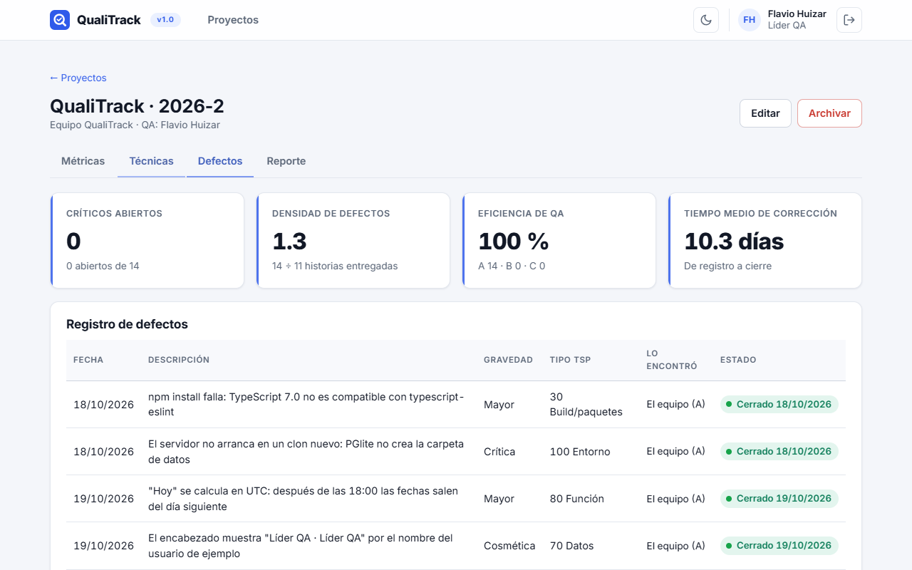

El registro de defectos calcula solo cuatro métricas del modelo, que también aparecen en la pestaña Métricas:

| Indicador | Cómo se calcula |
| --- | --- |
| Críticos abiertos | Defectos de gravedad crítica sin cerrar |
| Densidad de defectos | Total de defectos ÷ historias entregadas del proyecto |
| Eficiencia de QA | Defectos que encontró el equipo (A) ÷ todos (A + B cliente + C usuario) |
| Tiempo medio de corrección | Días promedio desde que se registra hasta que se cierra |

**Registrar un defecto:**
1. Escribe la **Descripción**: qué falla y dónde.
2. Elige la **Gravedad** (crítica, mayor, menor o cosmética) y el **Tipo TSP** (por ejemplo 50 Interfaz u 80 Función).
3. En **Lo encontró**, elige equipo, cliente o usuario, y revisa la **Fecha**.
4. Da clic en **+ Registrar defecto**.

**Cerrar un defecto:** en su fila, revisa la fecha de cierre (no puede ser anterior a la de registro) y da clic en **Cerrar**. El estado cambia a "Cerrado" con la fecha.

Si el proyecto no tiene historias entregadas, la densidad no se puede calcular; captúralas con **Editar**.

## 8. Reporte de salud

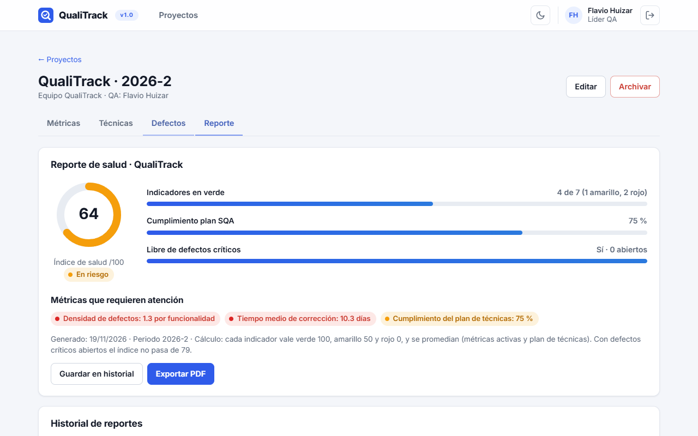

- **Índice de salud (0 a 100):** cada indicador vale 100 si está en verde, 50 en amarillo y 0 en rojo, y se promedian las métricas activas y el cumplimiento del plan de técnicas. **Con un defecto crítico abierto, el índice no pasa de 79**, aunque todo lo demás esté en verde.
- **Las barras:** indicadores en verde, cumplimiento del plan y si el proyecto está libre de defectos críticos.
- **Métricas que requieren atención:** las que están en amarillo o en rojo, con su valor.
- **Guardar en historial:** guarda el índice de hoy con un resumen. Sirve para comparar check-ins.
- **Exportar PDF:** abre el diálogo de impresión del navegador; elige "Guardar como PDF". El reporte sale siempre en tema claro y sin botones.

## 9. Usuarios (solo Administrador)

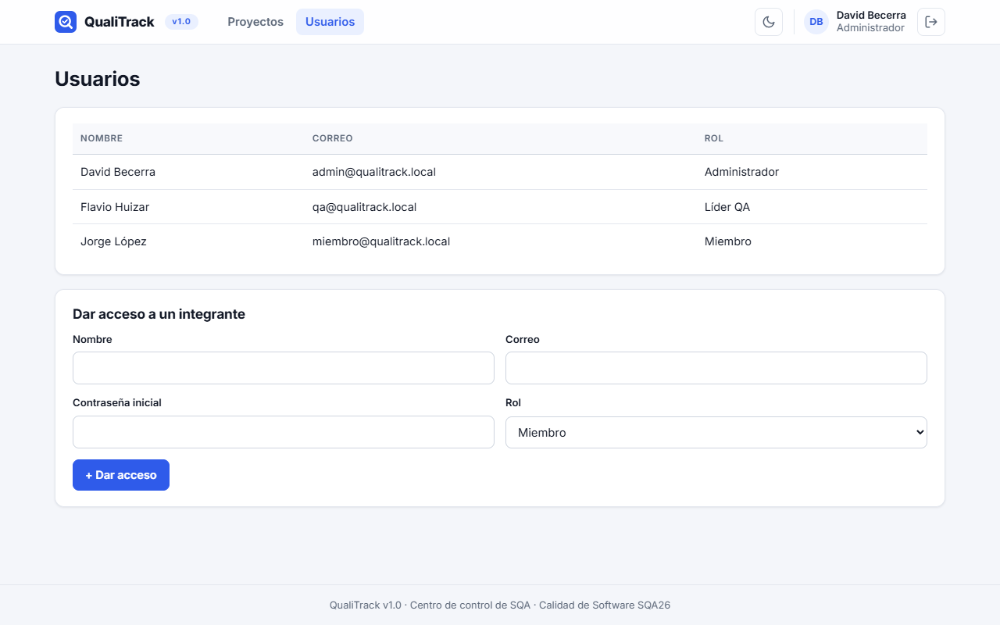

Desde el menú **Usuarios**:
1. Captura nombre, correo, contraseña (8 caracteres o más) y rol.
2. Da clic en **+ Dar acceso**.

La persona ya puede entrar, y aparece en las listas de responsables de proyectos y ejecuciones. Un correo repetido se rechaza con un mensaje que lo dice.

En la versión 1.0 esta pantalla solo crea cuentas: no edita ni da de baja usuarios, ni cambia contraseñas.

## 10. Modo oscuro y celular

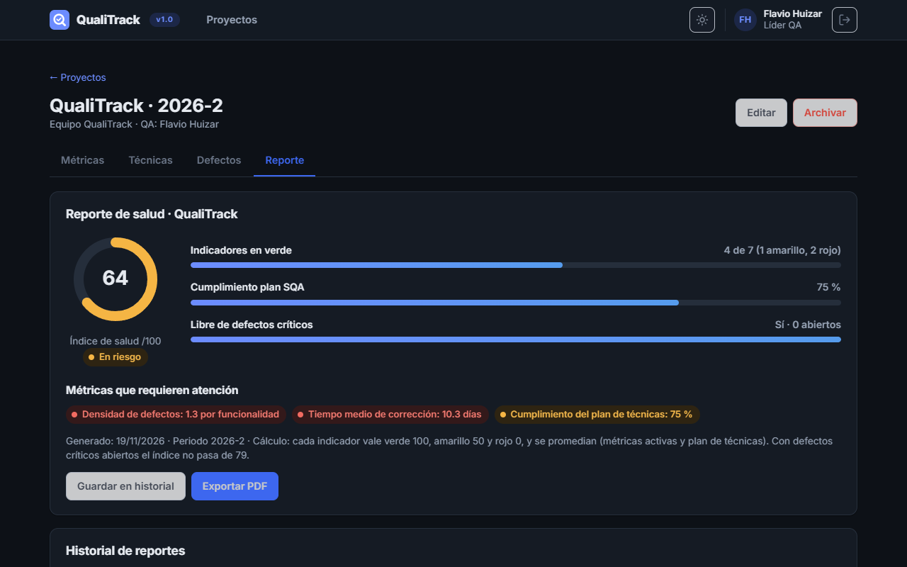

El botón de la luna o del sol, en el encabezado, cambia entre modo claro y oscuro. La elección se guarda en el navegador. La primera vez se usa la del sistema operativo.

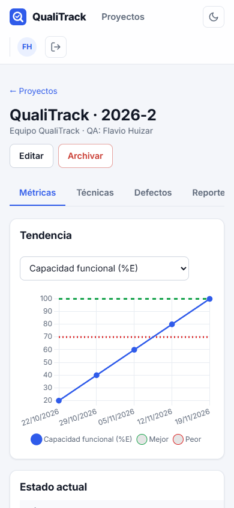

En celular el contenido se acomoda en una columna. Las pestañas del proyecto se desplazan de lado.

## 11. Mensajes frecuentes

| Mensaje | Qué hacer |
| --- | --- |
| Correo o contraseña incorrectos | Revisa los dos datos; si olvidaste la contraseña, pídele al Administrador una cuenta nueva |
| La sesión expiró o no es válida | Vuelve a iniciar sesión |
| Tu rol no tiene permiso para esta acción | Tu rol no permite esa acción (sección 1) |
| Ya hay un proyecto llamado "…" en el periodo … | Cambia el nombre o el periodo |
| Esa técnica ya está en el plan | Registra una ejecución en lugar de agregarla otra vez |
| El proyecto está archivado; no admite nuevos defectos | Restáuralo para registrar defectos o mediciones |
| Escribe un correo válido, por ejemplo nombre@dominio.mx | Corrige el formato del correo |

La primera visita a la dirección de Render puede tardar cerca de un minuto: el plan gratuito apaga el servidor tras 15 minutos sin uso.
